<p align="center">
  
</p>

<p align="center">
  
  
  
  
  
  
</p>

<p align="center">
  <b>Корпоративный сайт производственно-строительной компании</b><br>
  с собственной CMS, заявками на расчёт и SEO, рассчитанным на поисковики и нейросети.
</p>

<p align="center"></p>

## О проекте

«Росметстрой» проектирует, организует изготовление по чертежам и монтирует металлоконструкции, выполняет внутреннюю
отделку помещений и организует доставку инженерного оборудования. IT-решения — через партнёрскую студию.

<p align="center">
  
</p>

| | Сайт | Админ-панель `/admin` |
|---|---|---|
| **Контент** | Услуги, проекты с галереями, блог, FAQ, «Работа с металлом», свои страницы | Редактор блоков страниц, скрытие блоков, медиатека, визуальный редактор статей |
| **Заявки** | Форма расчёта с чертежами (PDF, DWG, DXF, ZIP), защита от спама | Статусы, комментарии, вложения, уведомления на e-mail и в Telegram |
| **Опыт** | Плавная прокрутка, анимации GSAP и Motion, адаптив, `prefers-reduced-motion` | Командная палитра <kbd>Ctrl</kbd>+<kbd>K</kbd>, роли admin / editor, журнал действий |
| **Видимость** | schema.org, `sitemap.xml`, `llms.txt` для нейросетей, IndexNow | Коды Яндекс Вебмастера, Google и Bing, SEO-поля у каждой страницы |

Изменения в CMS появляются на сайте сразу: после сохранения backend сбрасывает кэш Next.js по тегам
и уведомляет Яндекс и Bing через IndexNow.

<p align="center"></p>

## Стек

| Слой | Технологии |
|---|---|
| **Frontend** | Next.js 16 (App Router, Cache Components) · React 19 · TypeScript · Tailwind CSS 4 · GSAP · Motion · Lenis · Zustand · React Hook Form + Zod · TipTap |
| **Backend** | FastAPI · Pydantic v2 · SQLAlchemy 2 (async) · Alembic · PostgreSQL · Argon2id |
| **Инфраструктура** | Docker · Caddy 2 (HTTPS, reverse proxy) |

```text
├── front/             Next.js: публичный сайт  src/app/(site)  и админка  src/app/admin
├── back/              FastAPI: app/api/v1 · models · schemas · services · alembic · tests
├── deploy/platform/   Caddy и скрипт запуска единого образа
├── Dockerfile         Единый образ: сайт + API на порту 8080
└── docker-compose.yml Отдельные сервисы для своего сервера
```

<p align="center"></p>

## Быстрый старт

Нужны **Node.js 22**, **Python 3.12+** и **Docker**.

**1. База данных**

```bash
docker compose -f docker-compose.dev.yml up -d
```

**2. Backend** — http://localhost:8000

```bash
cd back
python -m venv .venv && .venv/Scripts/pip install -r requirements-dev.txt   # Linux/macOS: .venv/bin/...
cp .env.example .env
.venv/Scripts/alembic upgrade head
.venv/Scripts/python -m app.cli seed
.venv/Scripts/python -m app.cli create-admin --email admin@rosmetstroy.local
.venv/Scripts/uvicorn app.main:app --reload --port 8000
```

**3. Frontend** — http://localhost:3001, админка — http://localhost:3001/admin

```bash
cd front && npm ci && cp .env.example .env.local && npm run dev
```

<details>
<summary><b>Проверки качества</b></summary>

```bash
cd back && .venv/Scripts/ruff check app tests && .venv/Scripts/pytest
```

```bash
cd front && npm run typecheck && npm run lint && npm run build
```

Тесты используют базу `rosmetstroy_test`:
`docker compose -f docker-compose.dev.yml exec postgres createdb -U rosmetstroy rosmetstroy_test`.
Типы API для фронтенда генерируются из OpenAPI: `npm run api:types` (backend должен быть запущен).

</details>

<p align="center"></p>

## Деплой

### Один контейнер

Корневой `Dockerfile` собирает сайт, API и прокси в один образ: порт `8080`, проверка `/healthz`,
файлы хранятся в PostgreSQL. Нужны переменные `DATABASE_URL`, `SECRET_KEY`, `PUBLIC_SITE_URL`, а для первого
запуска ещё `ADMIN_EMAIL` и `ADMIN_PASSWORD`. Миграции, стартовый контент и первый администратор
создаются при старте автоматически.

```bash
docker build -t rosmetstroy . && docker run -p 8080:8080 --env-file .env rosmetstroy
```

Подробно — в [docs/deploy-platform.md](docs/deploy-platform.md).

### Свой сервер (VPS)

Скопируйте `.env.example` в `.env`, задайте домен и секреты, затем:

```bash
docker compose up -d --build
```

```bash
docker compose exec backend python -m app.cli seed
```

```bash
docker compose exec backend python -m app.cli create-admin --email admin@rosmetstroy.ru
```

Caddy сам выпустит сертификат Let's Encrypt для `SITE_DOMAIN`.

<details>
<summary><b>Эксплуатация</b></summary>

| Задача | Команда |
|---|---|
| Обновить после изменений | `git pull && docker compose up -d --build` |
| Логи | `docker compose logs -f backend frontend caddy` |
| Сбросить пароль администратора | `docker compose exec backend python -m app.cli create-admin --email ...` |
| Резервная копия БД | `docker compose exec postgres sh -c 'pg_dump -U "$POSTGRES_USER" -d "$POSTGRES_DB" -Fc -f /backups/db-$(date +%F).dump'` |
| Восстановить БД | `docker compose exec postgres sh -c 'pg_restore -U "$POSTGRES_USER" -d "$POSTGRES_DB" --clean --if-exists /backups/db-ГГГГ-ММ-ДД.dump'` |

Медиа можно хранить в S3-совместимом хранилище: `STORAGE_BACKEND=s3` и переменные `S3_*`.
Уведомления о заявках: `SMTP_*` + `NOTIFY_EMAILS` и/или `TELEGRAM_BOT_TOKEN` + `TELEGRAM_CHAT_ID`.

</details>

<details>
<summary><b>Безопасность</b></summary>

- Сессии в базе, cookie `httpOnly` + `SameSite=Lax` (`Secure` в production), CSRF по схеме double-submit.
- Пароли — Argon2id; ограничение попыток входа и отправки заявок.
- Заявки: подписанный токен формы и поле-ловушка; загрузки проверяются по содержимому, вложения доступны только в админке.
- HTML статей очищается на сервере; CSP и заголовки безопасности — в Caddy.

</details>

<details>
<summary><b>SEO и нейросети</b></summary>

- Метаданные, canonical и Open Graph у каждой страницы, разметка schema.org одним графом: организация,
  услуги с FAQ, проекты, статьи, каталоги, хлебные крошки.
- `/llms.txt` и `/llms-full.txt` — описание компании для ChatGPT, Claude, Perplexity, Gemini и Алисы, собирается из CMS.
- `robots.txt` открыт для поисковых и AI-краулеров; закрыты только `/admin` и `/api/`.
- IndexNow отправляет Яндексу и Bing изменённые страницы после каждого сохранения в CMS.

После запуска подтвердите сайт в Яндекс Вебмастере и Google Search Console (коды вводятся в
«Настройки сайта → Поисковые системы») и отправьте `sitemap.xml`.

</details>

<p align="center"></p>

<p align="center">
  <sub>© ООО «Комплексные решения» · г. Москва, ул. Первомайская, д. 19, помещение 2П · <a href="mailto:info@rosmetstroy.ru">info@rosmetstroy.ru</a></sub>
</p>
